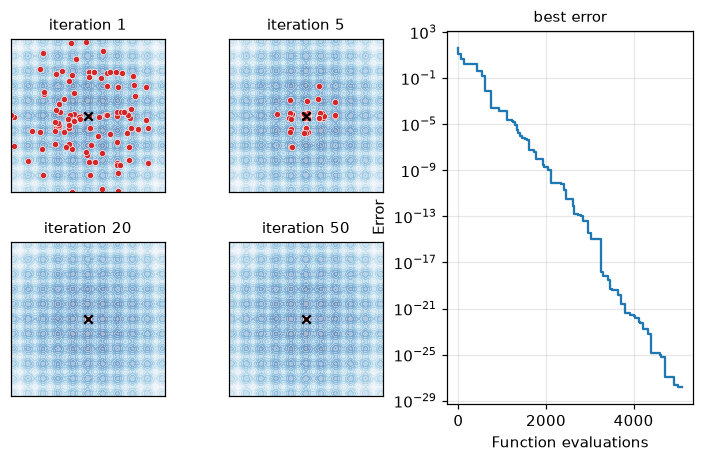

# Genetic Algorithm (GA)

::: ypea.algorithms.ga.GA

The common settings (`max_iter`, `pop_size`, `max_nfe`, `target`, `max_time` and `display`) are described in [Algorithms](../guide/algorithms.md#common-settings).

With `space="native"` the algorithm uses operators made for each variable type. See [Native operators](../guide/operators.md).

## Long runs and combinatorial problems

The mutation step is multiplied by `mutation_step_size_damp` (0.99 by default) after every iteration, so after 500 iterations it is less than 1% of its start value. On continuous problems this gives the final precision. On routes, assignments and knapsacks the search then stops moving, and more evaluations do not help. For those problems, and for long runs, set `mutation_step_size_damp=1`. In a benchmark of 15 runs on random and circle TSPs and the OR-Library knapsacks at 50 000 evaluations, it had the better mean on 10 of 11 problems (one tie), significantly better on two (Friedman p = 0.002). On the classic functions at 30 dimensions it was worse, which is why the default stays 0.99.

## Example

Minimize the sphere function in 20 dimensions with the settings of the YPEA for MATLAB example (`examples/sphere_all.py` runs every algorithm):

```python
import ypea

problem = ypea.Problem(ypea.Real("x", shape=20, lb=-10, ub=10),
                       lambda sol: ypea.benchmarks.sphere(sol.x), vectorized=True, name="sphere")

alg = ypea.GA(max_iter=1000, pop_size=100, crossover_prob=0.7, crossover_inflation=0.4,
              mutation_prob=0.3, mutation_rate=0.1, mutation_step_size=0.5,
              mutation_step_size_damp=0.99, selection="roulettewheel", selection_pressure=5)
result = alg.solve(problem, seed=1)
print(result.summary())
```

## How it searches

<figure markdown="span">
  
  <figcaption>The current solutions of GA with default settings on the Rastrigin function in two dimensions (seed 1), after 1, 5, 20 and 50 iterations. The cross marks the global minimum. The right panel shows the error of the best solution against the evaluations.</figcaption>
</figure>
