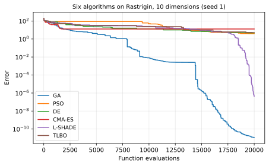

# Algorithms

Every algorithm is a class with its settings as keyword arguments and a `solve(problem, seed=None, callbacks=(), executor=None)` method. Each page below is generated from the docstring of the class: the signature gives every setting with its default, and the text gives the method, the meaning of each setting, the differences from the paper and the references.

For the common settings, the stopping rules, seeds and choosing an algorithm, see the user guide page [Algorithms](../guide/algorithms.md).

In the table, n is the number of codes of the problem (the number of real variables for a continuous problem).

<figure markdown="span">
  
  <figcaption>Six algorithms with default settings on Rastrigin in 10 dimensions (20 000 evaluations, seed 1). One run says little, so compare algorithms with the experiment runner.</figcaption>
</figure>

## From YPEA for MATLAB

The 15 algorithms of YPEA for MATLAB, with their known defects fixed. [Differences from YPEA for MATLAB](../differences-from-matlab.md) lists every change.

| Class | Algorithm | Default population |
|---|---|---|
| [`ABC`](abc.md) | Artificial Bee Colony | 100 |
| [`ACOR`](acor.md) | Ant Colony Optimization for Continuous Domains | 100 |
| [`BA`](ba.md) | Bees Algorithm | 100 |
| [`BBO`](bbo.md) | Biogeography-based Optimization | 100 |
| [`CA`](ca.md) | Cultural Algorithm | 100 |
| [`CMAES`](cmaes.md) | Covariance Matrix Adaptation Evolution Strategy | 4 + floor(3 ln n) |
| [`DE`](de.md) | Differential Evolution | 100 |
| [`FA`](fa.md) | Firefly Algorithm | 100 |
| [`GA`](ga.md) | Genetic Algorithm | 100 |
| [`HS`](hs.md) | Harmony Search | 10 |
| [`ICA`](ica.md) | Imperialist Competitive Algorithm | 100 |
| [`IWO`](iwo.md) | Invasive Weed Optimization | 20 |
| [`PSO`](pso.md) | Particle Swarm Optimization | 100 |
| [`SA`](sa.md) | Simulated Annealing | 10 |
| [`TLBO`](tlbo.md) | Teaching-Learning-Based Optimization | 100 |

## New in YPEA for Python

Four modern baselines for benchmark studies and two reference methods. See also [New algorithms](../new-algorithms.md).

| Class | Algorithm | Default population |
|---|---|---|
| [`JADE`](jade.md) | Adaptive Differential Evolution with Optional External Archive | 100 |
| [`SHADE`](shade.md) | Success History based Adaptive Differential Evolution | 100 |
| [`LSHADE`](lshade.md) | Success History based Adaptive Differential Evolution with Linear Population Size Reduction | 18 n, falling to 4 |
| [`IPOPCMAES`](ipop-cmaes.md) | CMA-ES with Restarts and Increasing Population Size | 4 + floor(3 ln n), doubled at each restart |
| [`NelderMead`](nelder-mead.md) | Nelder-Mead Simplex | n + 1 vertices |
| [`RandomSearch`](random-search.md) | Random Search | 100 |

## Multiple objectives

Algorithms for problems with several objectives. See [Multiple objectives](../guide/multi-objective.md). In the table, H is the number of reference points.

| Class | Algorithm | Default population |
|---|---|---|
| [`NSGAII`](nsga2.md) | Non-dominated Sorting Genetic Algorithm II | 100 |
| [`NSGAIII`](nsga3.md) | Non-dominated Sorting Genetic Algorithm III | the smallest multiple of 4 at least H |
| [`MOEAD`](moead.md) | Multiobjective Evolutionary Algorithm Based on Decomposition | the largest Das and Dennis lattice with at most 100 points |
| [`MOPSO`](mopso.md) | Multi-Objective Particle Swarm Optimization | 100 |
| [`SPEA2`](spea2.md) | Strength Pareto Evolutionary Algorithm 2 | 100, archive 100 |
