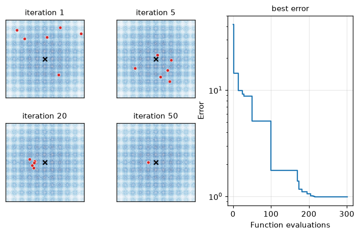

# CMA-ES with Restarts and Increasing Population Size (IPOP-CMA-ES)

::: ypea.algorithms.ipop_cmaes.IPOPCMAES

The common settings (`max_iter`, `pop_size`, `max_nfe`, `target`, `max_time` and `display`) are described in [Algorithms](../guide/algorithms.md#common-settings).

## Example

Minimize the sphere function in 20 dimensions with a budget of evaluations:

```python
import ypea

problem = ypea.Problem(ypea.Real("x", shape=20, lb=-10, ub=10),
                       lambda sol: ypea.benchmarks.sphere(sol.x), vectorized=True, name="sphere")

alg = ypea.IPOPCMAES(max_nfe=20_000)
result = alg.solve(problem, seed=1)
print(result.summary())
```

## How it searches

<figure markdown="span">
  
  <figcaption>The current solutions of IPOP-CMA-ES with default settings on the Rastrigin function in two dimensions (seed 1), after 1, 5, 20 and 50 iterations. The cross marks the global minimum. The right panel shows the error of the best solution against the evaluations.</figcaption>
</figure>
