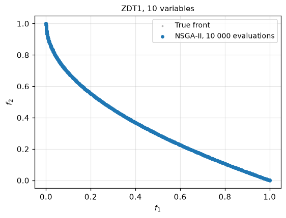

# NSGA-II

::: ypea.algorithms.nsga.NSGAII

The common settings (`max_iter`, `pop_size`, `max_nfe`, `max_time` and `display`) are described in [Algorithms](../guide/algorithms.md#common-settings). `target` does not apply to several objectives. The result holds the front of every non-dominated solution found (see [Multiple objectives](../guide/multi-objective.md#the-front)), not only the last population.

## Example

Solve ZDT1 (30 variables, two objectives) and measure the distance of the front to the true Pareto front:

```python
import ypea
from ypea.benchmarks import pareto_front, zdt1
from ypea.indicators import igd

problem = ypea.Problem(ypea.Real("x", shape=30), lambda sol: zdt1(sol.x), n_obj=2,
                       vectorized=True, name="zdt1")
result = ypea.NSGAII(max_nfe=5_000).solve(problem, seed=1)
print(len(result.front), igd(result.front.obj_values, pareto_front("zdt1", 1000)))
```

Other operators from `ypea.operators` replace the defaults, for example `ypea.NSGAII(crossover=ypea.operators.SBX(eta=15))`.

## How it searches

<figure markdown="span">
  
  <figcaption>The front of NSGA-II with default settings on ZDT1 with 10 variables after 10 000 evaluations (seed 1), with the true front in gray.</figcaption>
</figure>
