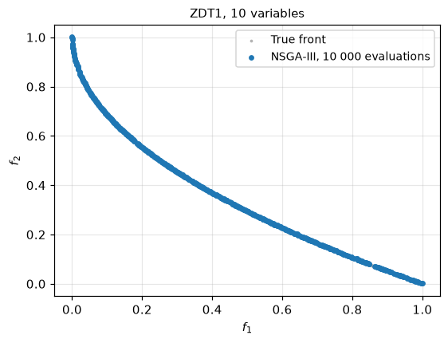

# NSGA-III

::: ypea.algorithms.nsga.NSGAIII

The common settings (`max_iter`, `pop_size`, `max_nfe`, `max_time` and `display`) are described in [Algorithms](../guide/algorithms.md#common-settings). `target` does not apply to several objectives. The result holds the front of every non-dominated solution found (see [Multiple objectives](../guide/multi-objective.md#the-front)), not only the last population.

## Reference points and population size

| Objectives | `divisions` | Reference points | Population | Source |
|---|---|---|---|---|
| 2 | 99 | 100 | 100 | our choice |
| 3 | 12 | 91 | 92 | Table I of the paper |
| 4 | 8 | 165 | 168 | our choice |
| 5 | 6 | 210 | 212 | Table I |
| 6, 7, 9 | (3, 2) | 77, 112, 210 | 80, 112, 212 | our choice |
| 8 | (3, 2) | 156 | 156 | Table I |
| 10 | (3, 2) | 275 | 276 | Table I |
| 15 | (2, 1) | 135 | 136 | Table I |
| 11 to 14, 16 or more | (2, 1) | 77 for 11 | 80 for 11 | our choice |

`ypea.algorithms.nsga.reference_points(m, divisions)` gives the points, and `alg.ref_points` holds those of the last run.

## Example

Solve DTLZ2 with three objectives and compare the final population with the true front:

```python
import ypea
from ypea.benchmarks import dtlz2, pareto_front
from ypea.indicators import igd

problem = ypea.Problem(ypea.Real("x", shape=12), lambda sol: dtlz2(sol.x, m=3), n_obj=3,
                       vectorized=True, name="dtlz2")
alg = ypea.NSGAIII(max_nfe=5_000)
result = alg.solve(problem, seed=1)
print(len(alg.pop), igd(alg.pop.F, pareto_front("dtlz2", 1000, m=3)))
```

## How it searches

<figure markdown="span">
  
  <figcaption>The front of NSGA-III with default settings on ZDT1 with 10 variables after 10 000 evaluations (seed 1), with the true front in gray.</figcaption>
</figure>
