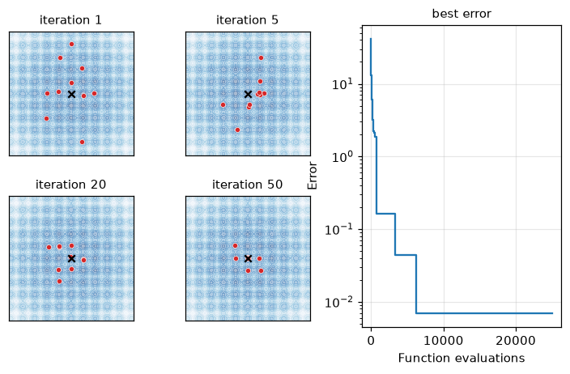

# Simulated Annealing (SA)

::: ypea.algorithms.sa.SA

The common settings (`max_iter`, `pop_size`, `max_nfe`, `target`, `max_time` and `display`) are described in [Algorithms](../guide/algorithms.md#common-settings).

With `space="native"` the algorithm uses operators made for each variable type. See [Native operators](../guide/operators.md).

## Example

Minimize the sphere function in 20 dimensions (the MATLAB example of SA solves a TSP, see `examples/tsp_sa.py`):

```python
import ypea

problem = ypea.Problem(ypea.Real("x", shape=20, lb=-10, ub=10),
                       lambda sol: ypea.benchmarks.sphere(sol.x), vectorized=True, name="sphere")

alg = ypea.SA(max_iter=100, pop_size=5, max_sub_iter=10, move_count=15)
result = alg.solve(problem, seed=1)
print(result.summary())
```

## How it searches

<figure markdown="span">
  
  <figcaption>The current solutions of SA with default settings on the Rastrigin function in two dimensions (seed 1), after 1, 5, 20 and 50 iterations. The cross marks the global minimum. The right panel shows the error of the best solution against the evaluations.</figcaption>
</figure>
