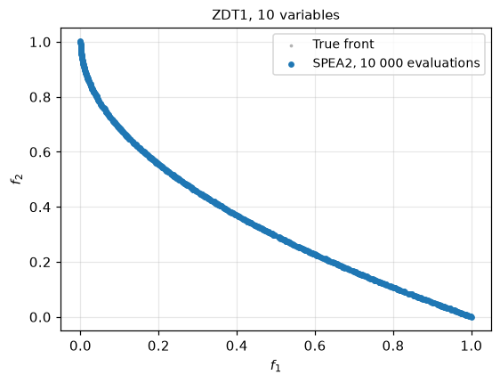

# Strength Pareto Evolutionary Algorithm 2 (SPEA2)

::: ypea.algorithms.spea2.SPEA2

The common settings (`max_iter`, `pop_size`, `max_nfe`, `target`, `max_time` and `display`) are described in [Algorithms](../guide/algorithms.md#common-settings). See [Multiple objectives](../guide/multi-objective.md) for problems with several objectives and the front.

## Example

Approximate the front of ZDT1 with 30 variables and measure its distance to the true front:

```python
import ypea
from ypea.benchmarks import pareto_front, zdt1
from ypea.indicators import igd

problem = ypea.Problem(ypea.Real("x", shape=30, lb=0, ub=1), lambda sol: zdt1(sol.x),
                       vectorized=True, n_obj=2, name="zdt1")

result = ypea.SPEA2(max_nfe=10_000).solve(problem, seed=1)
print(len(result.front), igd(result.front.obj_values, pareto_front("zdt1", 500)))
```

## How it searches

<figure markdown="span">
  
  <figcaption>The front of SPEA2 with default settings on ZDT1 with 10 variables after 10 000 evaluations (seed 1), with the true front in gray.</figcaption>
</figure>
