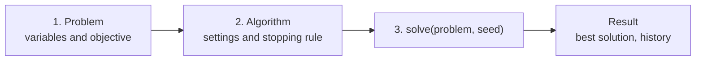
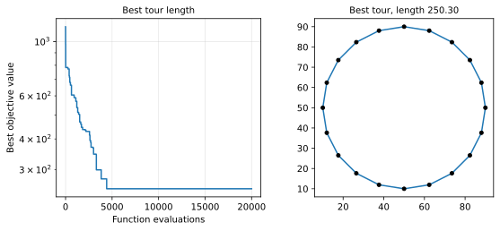

# Getting started

## Install

```text
pip install ypea
```

NumPy is the only required dependency. Two optional groups add more:

| Group | Adds | Needed for |
|---|---|---|
| `ypea[plot]` | matplotlib | `ypea.plot`, the figures of experiment reports, `plot_tour` and `plot_routes` |
| `ypea[stats]` | SciPy | the Wilcoxon rank sum marks and the Friedman p values in experiment tables |

To work on YPEA itself, clone the repository and install it in editable mode with the test tools:

```text
pip install -e ".[dev]"
pytest
```

## Three steps

Every optimization in YPEA has the same three steps: define the problem, choose an algorithm, and call `solve`.



**1. Define the problem.** A problem has decision variables and an objective function. The objective gets a decoded solution, with one attribute per variable, and returns a number.

```python
import numpy as np
import ypea


def rastrigin(sol):
    x = sol.x
    return 10 * len(x) + np.sum(x**2 - 10 * np.cos(2 * np.pi * x))


problem = ypea.Problem(ypea.Real("x", shape=10, lb=-5.12, ub=5.12), rastrigin)
```

The default sense is minimization. Use `sense="max"` to maximize.

**2. Choose an algorithm.** Settings go to the constructor and are checked there. Every algorithm has the common settings `max_iter`, `pop_size`, `max_nfe` (the number of function evaluations), `target`, `max_time` and `display`.

```python
de = ypea.DE(max_nfe=30_000, pop_size=50)
```

**3. Solve.** `solve` returns a `Result`. The same seed gives the same result.

```python
result = de.solve(problem, seed=1)
print(result.summary())
print(result.best.solution.x.round(3))
```

```text
DE on rastrigin
  best objective value: 4.26326e-13
  feasible: True (violation 0)
  evaluations: 30000, iterations: 599, time: 0.208 s, stopped by: max_nfe
[ 0. -0.  0.  0.  0. -0.  0.  0. -0.  0.]
```

## Try other algorithms

All algorithms take the same problem, so comparing them is a loop:

```python
for alg in (ypea.PSO(), ypea.GA(), ypea.LSHADE(), ypea.IPOPCMAES()):
    r = alg.solve(problem, seed=1)
    print(f"{alg.short_name:12s} {r.best.obj_value:10.4g}")
```

```text
PSO               50.08
GA              0.04109
L-SHADE           13.49
IPOP-CMA-ES       10.04
```

None of these settings gives a limit, so each run stops after 100 iterations. Set `max_nfe` to give every algorithm the same budget. For real comparisons with many runs, statistics and tables, use an [experiment](guide/experiments.md).

## Constraints

The objective may also return the constraint values `g`. A constraint is satisfied when its value is at most 0:

```python
def circle(sol):
    x, y = sol.x
    f = (x - 2) ** 2 + (y - 1) ** 2
    g = x**2 + y**2 - 1  # stay inside the unit circle
    return f, g


problem = ypea.Problem(ypea.Real("x", shape=2, lb=-2, ub=2), circle)
result = ypea.LSHADE(max_nfe=5_000).solve(problem, seed=1)
print(result.best.solution.x.round(4), result.best.feasible)
```

```text
[0.8944 0.4472] True
```

The exact solution is (2, 1) / sqrt(5), the point of the circle closest to (2, 1).

See [Objectives and constraints](guide/objectives.md) for the rules that compare feasible and infeasible solutions.

## A combinatorial problem

Variables of other types work the same way. A traveling salesman problem has one permutation variable:

```python
problem = ypea.problems.circle_tsp(20, seed=1)  # 20 cities on a circle
result = ypea.GA(max_nfe=20_000, space="native").solve(problem, seed=1)
print(result.best.obj_value, problem.optimum)
print(result.best.solution.tour)
```

```text
250.29514406436937 250.2951440643694
[14  0  9 10 11 12 18  4 13 15  1  5  6 17 16  8  3  7  2 19]
```

The tour is optimal: its length equals the perimeter of the polygon, up to rounding.

`space="native"` lets GA use crossovers and moves made for permutations. See [Native operators](guide/operators.md).

## Plot the convergence

With matplotlib installed:

```python
ax = ypea.plot.convergence(result)
ax.figure.savefig("convergence.png")
```

<figure markdown="span">
  
  <figcaption>The TSP example above: the best tour length against the evaluations (left) and the optimal tour (right).</figcaption>
</figure>

## Examples

The `examples` folder of the repository has complete scripts, most of them Python versions of the YPEA for MATLAB documentation:

| Script | What it shows |
|---|---|
| `sphere_pso.py` | PSO on the sphere function, constriction coefficients, a convergence plot |
| `sphere_all.py` | every algorithm on the sphere function, with the settings of its MATLAB example |
| `max_problem.py` | a maximization problem with three variables |
| `knapsack.py` | a binary knapsack with a constraint, feasibility rules and a penalty |
| `tsp_sa.py` | a TSP solved with Simulated Annealing, with a plot of the tour |
| `tsp_ga_native.py` | GA and SA with native permutation operators, and custom operators |
| `ask_tell.py` | evaluating the solutions outside the toolbox with ask and tell |
| `variables.py` | every variable type with decoded samples |
| `experiment_cec2017.py` | three algorithms on CEC 2017 with tables and an HTML report |

Each runs in a few seconds, for example `python examples/tsp_sa.py`.

## Next steps

- [Problems and variables](guide/problems.md): every variable type.
- [Algorithms](guide/algorithms.md): choosing one, stopping rules and seeds.
- [Results and plots](guide/results.md): what a run returns.
- [Differences from YPEA for MATLAB](differences-from-matlab.md), if you know the MATLAB toolbox.
