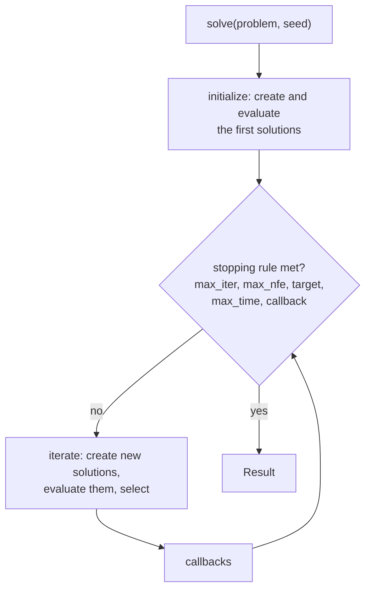

# Algorithms

## The algorithms

YPEA has 26 algorithms. Each has its own page with every setting, its default and the reference paper (see the [list of algorithms](../algorithms/index.md)).

| Family | Algorithms |
|---|---|
| Evolutionary | [GA](../algorithms/ga.md), [DE](../algorithms/de.md), [BBO](../algorithms/bbo.md), [CA](../algorithms/ca.md), [ICA](../algorithms/ica.md), [IWO](../algorithms/iwo.md), [HS](../algorithms/hs.md), [TLBO](../algorithms/tlbo.md) |
| Swarm intelligence | [PSO](../algorithms/pso.md), [ABC](../algorithms/abc.md), [ACOR](../algorithms/acor.md), [BA](../algorithms/ba.md), [FA](../algorithms/fa.md) |
| Evolution strategies | [CMA-ES](../algorithms/cmaes.md), [IPOP-CMA-ES](../algorithms/ipop-cmaes.md) |
| Adaptive DE | [JADE](../algorithms/jade.md), [SHADE](../algorithms/shade.md), [L-SHADE](../algorithms/lshade.md) |
| Single solution | [SA](../algorithms/sa.md), [Nelder-Mead](../algorithms/nelder-mead.md) |
| Reference | [Random Search](../algorithms/random-search.md) |
| Multiple objectives | [NSGA-II](../algorithms/nsga2.md), [NSGA-III](../algorithms/nsga3.md), [MOEA/D](../algorithms/moead.md), [MOPSO](../algorithms/mopso.md), [SPEA2](../algorithms/spea2.md) |

## Choosing an algorithm

No algorithm is best on every problem, so compare a few on your problem with an [experiment](experiments.md). Some starting points:

- **Continuous problems, a budget of 10 000 evaluations per dimension or more:** L-SHADE and IPOP-CMA-ES are strong baselines on the CEC benchmarks. JADE and SHADE are close behind.
- **Smooth or badly scaled continuous problems, or a small budget:** CMA-ES adapts to the shape of the function. Nelder-Mead is a fast local method for a few variables.
- **A simple and robust first try:** DE or PSO, with few settings to choose.
- **Permutations, selections and binary problems:** GA and SA with `space="native"` use operators made for these types (see [Native operators](operators.md)). The other algorithms also work through the [0, 1] codes.
- **Several objectives:** NSGA-II for two or three objectives, NSGA-III for three or more (see [Multiple objectives](multi-objective.md)).
- **A baseline:** every method should beat Random Search with the same budget.

## How a run works



Every algorithm runs this loop. The evaluator counts every evaluation and never goes past `max_nfe`, and it updates the best solution after each evaluation, so the result does not depend on where in an iteration the budget ends.

## Common settings

Every algorithm accepts these keyword arguments, next to its own settings:

| Setting | Default | Meaning |
|---|---|---|
| `max_iter` | None | maximum number of iterations |
| `pop_size` | 100 | population size (some algorithms choose their own or use another default, see their pages) |
| `max_nfe` | None | maximum number of objective function evaluations |
| `target` | None | stop when a feasible solution at least this good is found |
| `max_time` | None | stop after this many seconds |
| `display` | False | print one line per iteration |

Settings are checked when the algorithm is made, and again when `solve` starts, so a value changed later is checked too:

```python
import ypea

de = ypea.DE(max_nfe=20_000, pop_size=50, crossover_prob=0.9)
de.crossover_prob = 0.5  # settings are plain attributes
print(de)
```

```text
DE(strategy='DE/rand/1/bin', base_vector='rand', diff_vectors_count=1, crossover_method='bin', crossover_prob=0.5, beta_min=0.5, beta_max=0.5, max_iter=None, pop_size=50, max_nfe=20000, target=None, max_time=None, display=False)
```

`de.params()` returns the same settings as a dict.

## Stopping rules

A run stops at the first limit it reaches:

- `max_nfe`: the budget is never exceeded, even in the middle of an iteration. Solutions past the budget are not evaluated.
- `max_iter`: the number of iterations. Iteration 0 is the initialization.
- `target`: a feasible solution with an objective value at least as good as `target` (at most for minimization, at least for maximization).
- `max_time`: checked between iterations, so the last iteration may end a little later.
- A callback that returns True (see [Callbacks](callbacks.md)).

`max_iter` defaults to None. When none of `max_iter`, `max_nfe` and `max_time` is given, the run stops after 100 iterations. When any of them is given, only the limits you set apply, so `max_nfe` alone is never cut short.

`result.stop_reason` tells which rule stopped the run: `"max_nfe"`, `"max_iter"`, `"target"`, `"max_time"` or `"callback"`. Two more can appear: `"no_evaluations"` when an iteration creates no new solutions (for example GA with a population of 1), and `"max_restarts"` for IPOP-CMA-ES.

```python
import numpy as np

problem = ypea.Problem(ypea.Real("x", shape=10, lb=-5, ub=5), lambda sol: np.sum(sol.x**2))
result = ypea.PSO(max_nfe=50_000, target=1e-6).solve(problem, seed=1)
print(result.stop_reason, result.nfe, result.best.obj_value)
```

```text
target 15800 8.038787146668577e-07
```

Schedules that must end with the run, such as the temperature of SA or the step size of IWO, follow whichever limit binds first.

## Reproducibility and seeds

`solve(problem, seed=...)` takes:

- an integer: the same integer gives the same result,
- a NumPy `Generator` or `SeedSequence`: the run draws from it,
- a `ypea.StudioRng` (see below),
- None (the default): a fresh random run.

Each run starts from a clean state, so the same algorithm object and the same seed always give the same result. Every random number of a run comes from its own generator, never from the global NumPy state:

```python
pso = ypea.PSO(max_nfe=5_000)
a = pso.solve(problem, seed=7).best.obj_value
b = pso.solve(problem, seed=7).best.obj_value
print(a == b)
```

```text
True
```

Algorithms pickle with their settings only, so they can be sent to worker processes or saved after a run, even when the objective was a lambda.

## The Studio generator

YPEA Studio is a companion app that runs the same algorithms. `ypea.StudioRng` is the random generator of Studio, a counter based Philox generator. With it, a run draws exactly the same numbers as Studio with the same seed, so a run in Python can repeat a run in the app:

```python
result = ypea.DE(max_nfe=5_000).solve(problem, seed=ypea.StudioRng(123))
print(result.best.obj_value)
```

```text
0.27341264743296173
```

The seed is an integer from 0 to 4294967295. `ypea.derive_seed(base, i)` gives the seed of run `i` of a Studio experiment with base seed `base`, and `Experiment(..., seeds="studio")` uses these seeds (see [Experiments](experiments.md)). Without a `StudioRng`, YPEA uses NumPy's default generator.

## Display

`display=True` prints the best value after every iteration. The `Print` callback gives more control (see [Callbacks](callbacks.md)).
