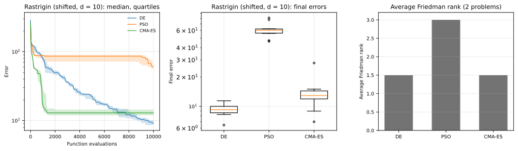

# Experiments and statistics

An experiment runs several algorithms on several problems, many times each, and compares them with tables, statistical tests and figures. `ypea.Experiment` runs and stores the runs, and `ypea.Report` analyzes them.

Statistical tests need SciPy (`pip install "ypea[stats]"`) and figures need matplotlib (`pip install "ypea[plot]"`). Without them, the tables still have the statistics and the Friedman ranks.

## Running an experiment

```python
import ypea
from ypea.experiment import Experiment

problems = ypea.benchmarks.cec2017(10, functions=[1, 5, 11])
algorithms = {"DE": ypea.DE(), "PSO": ypea.PSO(), "L-SHADE": ypea.LSHADE()}

exp = Experiment(algorithms, problems, runs=5, max_nfe=3_000, seed=2026, output="results/cec2017")
exp.run()
```

| Argument | Meaning |
|---|---|
| `algorithms` | a dict from label to algorithm, or a list (labeled by their short names) |
| `problems` | a list of problems with unique names |
| `runs` | runs of each algorithm on each problem (30 by default) |
| `max_nfe`, `max_iter` | the budget of every run. If either is given, it replaces the limits of every algorithm (on a copy). |
| `seed` | the base seed |
| `seeds` | `"numpy"` (default) or `"studio"`, see below |
| `n_jobs` | worker processes. The results are the same for any value. |
| `output` | a folder for the run files, or None to keep the runs in memory |
| `checkpoints` | fractions of `max_nfe` at which the best value and the error are recorded. The default is the CEC 2017 rule: 0.01, 0.02, 0.03, 0.05, 0.1, 0.2, ..., 1.0. |

With `n_jobs > 1` the runs go to a process pool, so the problems must be picklable: every ready made problem is, and your own objectives must be functions defined at the top level of a module, not lambdas. On Windows and macOS, put the script's code under `if __name__ == "__main__":`.

### Seeds

Every run has its own seed, so a result does not depend on `n_jobs`, on the order of the algorithms and problems, or on which of them are included:

- `seeds="numpy"`: run `i` of an algorithm on a problem uses `numpy.random.SeedSequence(seed, spawn_key=(a, p, i))`, where `a` and `p` are stable hashes of the label and the problem name. Every run has an independent stream.
- `seeds="studio"`: run `i` uses `ypea.StudioRng(ypea.derive_seed(seed, i))`, as YPEA Studio does. Run `i` then gets the same seed for every algorithm and problem (common random numbers).

### Resuming

The output folder holds `metadata.json` and one JSON file per run, `runs/<label>/<problem>/run_<i>.json`. Each file stores the full result, the values at the checkpoints and a key: a hash of the algorithm class and settings, the problem, the budget, the seed rule and the checkpoints. `run()` skips every run whose file has the same key. So an interrupted experiment continues where it stopped, new runs or problems are added without running the old ones again, and a run whose settings changed is run again:

```python
exp = Experiment(algorithms, problems, runs=6, max_nfe=3_000, seed=2026, output="results/cec2017")
exp.run()  # only run 5 of each pair is new
```

## Reports

`exp.report()` reads the runs. Later, `Report.load(folder)` does the same from the output folder alone:

```python
report = ypea.Report.load("results/cec2017")
report.zero_below = 1e-8  # the CEC rule: errors below 1e-8 count as 0
table = report.table(stat="mean", baseline="L-SHADE")
print(table)
```

For every problem, the table has the mean, standard deviation, best, worst and median of the final error, with the best value of each row in bold:

| Problem | Statistic | DE | PSO | L-SHADE |
|:---|:---|---:|---:|---:|
| cec2017_f1_d10 | Mean | 9.012e+08 − | 6.531e+09 − | **5.883e+06** |
|  | Std | 2.507e+08 | 1.658e+09 | 4.529e+06 |
|  | Best | 6.574e+08 | 4.521e+09 | **2.639e+06** |
|  | Worst | 1.220e+09 | 9.134e+09 | **1.491e+07** |
|  | Median | 8.487e+08 | 6.458e+09 | **4.708e+06** |
| cec2017_f5_d10 | Mean | 5.731e+01 − | 8.674e+01 − | **3.325e+01** |
|  | ... | | | |
| cec2017_f11_d10 | Mean | 3.075e+02 − | 9.015e+02 − | **2.849e+01** |
|  | ... | | | |
| +/=/− | vs L-SHADE | 0/0/3 | 0/0/3 | control |
| Friedman | Avg. rank | 2.00 | 3.00 | **1.00** |
|  | Holm APV | 0.221 | 0.0286 | control |

Below the table, notes name the tests and give the Friedman statistic and its p value. With so few runs and such a small budget, this example only shows the format: a real study needs more runs and the full budget.

The `metric` is the error `abs(f - optimum)` by default (`metric="error"`). On problems without a known optimum it falls back to the objective value, compared by the problem's sense. `metric="obj_value"` always uses the objective value.

### Statistical tests

The tests follow the tutorial of Derrac, Garcia, Molina and Herrera (2011):

- **Wilcoxon rank sum test** (the Mann Whitney U test) of each algorithm against the control on each problem, at `alpha=0.05`: `+` means significantly better than the control, `=` no significant difference, and `−` significantly worse. The `+/=/−` row counts them. The control is `baseline`, or the algorithm with the best Friedman rank. `test=None` leaves the test out.
- **Friedman test** over the problems, on the chosen statistic (`stat`, the mean by default): the average rank of each algorithm (lower is better), the Friedman statistic and the Iman and Davenport statistic, with their p values in the notes below the table.
- **Post hoc test**: each algorithm against the control with Holm adjusted p values (APV).

`table.data` holds the numbers behind the table, for example `table.data["friedman"]["ranks"]`. `report.values(label, problem)` gives the final values of the runs, and `report.curves(label, problem)` the best value of every run along the evaluations.

### Exporting tables

```python
table.to_csv("results/cec2017/table.csv")
table.to_markdown("results/cec2017/table.md")
table.to_latex("results/cec2017/table.tex", caption="Mean error on CEC 2017, D = 10", label="tab:cec")
table.to_html("results/cec2017/table.html")
```

Each method also returns the text. The LaTeX table uses booktabs (`\usepackage{booktabs}`), and `to_dataframe()` gives a pandas DataFrame if pandas is installed.

### Figures and the HTML report

```python
import matplotlib.pyplot as plt

ax = report.plot_convergence("cec2017_f5_d10")  # median and 25 to 75 percent band
ax.figure.savefig("results/cec2017/convergence_f5.pdf")
plt.close(ax.figure)

ax = report.plot_box("cec2017_f5_d10")  # final errors
ax = report.plot_ranks()  # Friedman ranks
plt.close("all")

path = report.save_html()  # results/cec2017/report.html
```

The figures are sized for one column of a paper (3.5 by 2.6 inches, 8 point text) and can be saved as PDF, PNG or SVG. `save_html` writes one self contained page with the settings, the algorithms, the table and every figure.

<figure markdown="span">
  
  <figcaption>The three report figures for a small experiment (DE, PSO and CMA-ES with default settings, shifted Rastrigin and Rosenbrock in 10 dimensions, 10 runs of 10 000 evaluations): <code>plot_convergence</code>, <code>plot_box</code> and <code>plot_ranks</code>.</figcaption>
</figure>

## Parameter sweeps

`Experiment.sweep` runs one algorithm with several settings, every combination of the given values:

```python
sweep = Experiment.sweep(ypea.DE, {"crossover_prob": [0.1, 0.9], "beta_max": [0.7, 0.9]},
                         problems[:2], runs=3, max_nfe=2_000)
print(list(sweep.algorithms))
```

```text
['DE(crossover_prob=0.1, beta_max=0.7)', 'DE(crossover_prob=0.1, beta_max=0.9)', 'DE(crossover_prob=0.9, beta_max=0.7)', 'DE(crossover_prob=0.9, beta_max=0.9)']
```

For automatic tuning with racing, see [Tuning](../tuning.md).

## Several objectives

An experiment may also compare multi-objective algorithms. Each run then stores its final front (in the result), and the IGD and hypervolume of the front at the end and at every checkpoint. The ready made benchmarks of `ypea.benchmarks.multi_problem` carry their true fronts, so they work as they are:

```python
from ypea.benchmarks import multi_problem

problems = [multi_problem("zdt1"), multi_problem("dtlz2", m=3), multi_problem("wfg4", m=3)]
algorithms = {"NSGA-II": ypea.NSGAII(), "MOEA/D": ypea.MOEAD(), "SPEA2": ypea.SPEA2()}
exp = Experiment(algorithms, problems, runs=5, max_nfe=5_000, seed=2026, output="results/multi")
report = exp.run().report()

report.table(metric="igd")           # lower is better
report.table(metric="hypervolume")   # higher is better
report.plot_convergence("zdt1_m2_d30", metric="igd")
```

The tables have the same statistics, Wilcoxon marks, `+/=/−` row and Friedman ranks as with one objective. The default `metric="error"` means IGD on these problems. `report.values(label, problem, "igd")` gives the final values, and `report.curves` the values at the checkpoints.

The indicators are computed for the feasible members of the front only, each objective turned into minimization:

- **IGD** is `ypea.indicators.igd` against the sampled true front `problem.info["pareto_front"]` (1000 points by default, see `front_points`), on the raw objective values, as most papers report it. Objectives with a larger range weigh more: the WFG objectives have the scales 2, 4, 6 and so on, so the later objectives dominate their IGD.
- **Hypervolume** is computed after each objective is normalized by the ideal point z and the nadir point n of the true front, f' = (f - z) / (n - z), with the reference point 1.1 in every normalized objective. So the values of different problems have the same scale, and the best possible value is below 1.1^m. It is exact for up to three objectives and a seeded Monte Carlo estimate for more.

For your own problem, give the true front as `info={"pareto_front": F}` (an array of shape (n, m) in the problem's own objective values), or, if it is not known, a reference point as `info={"ref_point": r}`. With only a reference point, the report has the hypervolume of the raw objective values and no IGD. A reference point given together with a front replaces the 1.1 point (it is normalized like the values). A problem with neither raises an error when the experiment is made.

Runs without `max_nfe` have no checkpoints, so they have final values but no convergence plots. `ypea.tune` (racing) needs one value per run and so accepts only single objective problems, but `ypea.tuning.sweep` works with several objectives and returns this report.

`examples/experiment_cec2017.py` is a complete script with all of these steps.
