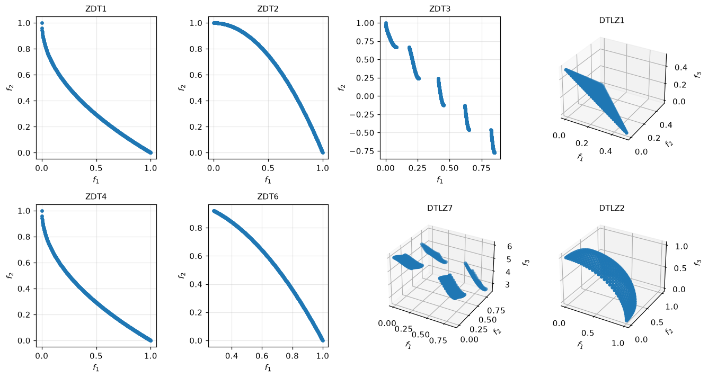
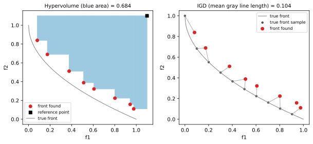

# Multi-objective benchmarks

`ypea.benchmarks` has the three standard suites of multi-objective test problems, ZDT, DTLZ and WFG, with samples of their true Pareto fronts. `ypea.indicators` measures how close a set of objective vectors is to a front, and `ypea.plot.front` draws fronts. All objectives are minimized.

The functions take one point with shape (d,) or a batch with shape (..., d) and return the objective values with shape (..., m), so they work in vectorized objectives.

```python
import numpy as np
import ypea

print(ypea.benchmarks.dtlz2(np.full(12, 0.5), m=3))
```

```text
[0.5        0.5        0.70710678]
```

## Problems

| Problems | Objectives | Variables | Bounds | Pareto front |
|---|---|---|---|---|
| `zdt1`, `zdt2`, `zdt3` | 2 | 30 | [0, 1] | convex, concave, five disconnected parts |
| `zdt4` | 2 | 10 | x1 in [0, 1], the rest in [-5, 5] | convex, 21^9 local fronts |
| `zdt5` | 2 | 80 bits | 0 or 1 | 31 discrete points |
| `zdt6` | 2 | 10 | [0, 1] | concave, nonuniform |
| `dtlz1` | m | m - 1 + 5 | [0, 1] | linear, sum f = 0.5 |
| `dtlz2`, `dtlz3`, `dtlz4` | m | m - 1 + 10 | [0, 1] | sphere, sum f^2 = 1 |
| `dtlz5`, `dtlz6` | m | m - 1 + 10 | [0, 1] | degenerate curve on the sphere |
| `dtlz7` | m | m - 1 + 20 | [0, 1] | 2^(m - 1) disconnected parts |
| `wfg1` | m | k + 20 | x_i in [0, 2 i] | convex and mixed |
| `wfg2` | m | k + 20 | x_i in [0, 2 i] | convex and disconnected |
| `wfg3` | m | k + 20 | x_i in [0, 2 i] | linear and degenerate |
| `wfg4` to `wfg9` | m | k + 20 | x_i in [0, 2 i] | concave, sum (f_i / 2 i)^2 = 1 |

The DTLZ functions take the number of objectives `m` (default 3) and use the remaining k = d - m + 1 variables as the distance variables. The WFG functions take `m` (default 3) and the number of position parameters `k` (default 2 (m - 1), and it must be a multiple of m - 1). The other variables are distance parameters, 20 by default, and WFG2 and WFG3 need an even number of them.

`ypea.benchmarks.multi.REGISTRY` holds the metadata of each problem:

```python
b = ypea.benchmarks.multi.REGISTRY["wfg4"]
print(b.default_dim(3), b.bounds(4), b.front)
```

```text
24 (array([0., 0., 0., 0.]), array([2., 4., 6., 8.])) concave
```

`zdt5` is a binary problem: its input holds the bits, 30 for the first variable and 5 for each of the others.

### As problems

`multi_problem(name, m=None, dim=None, front_points=1000)` gives a benchmark as a vectorized `Problem`, with the usual bounds and size, and its sampled true front in `info["pareto_front"]`:

```python
from ypea.benchmarks import multi_problem

problem = multi_problem("dtlz2", m=3)
print(problem.name, problem.n_obj, problem.info["pareto_front"].shape)
```

```text
dtlz2_m3_d12 3 (990, 3)
```

The name is `<name>_m<m>_d<dim>`. ZDT5 has one `Binary` variable with its bits, and the others one `Real` variable `x`. The [experiment runner](experiments.md#several-objectives) uses the true front for IGD and hypervolume.

The definitions follow Zitzler, Deb and Thiele (2000) for ZDT, the ETH TIK report 112 of Deb, Thiele, Laumanns and Zitzler (2001) for DTLZ, and Huband, Hingston, Barone and While (2006) for WFG. The values agree with pymoo 0.6.2 to about 1e-14 at random points, at the bounds and at Pareto optimal solutions.

## True Pareto fronts

`pareto_front(name, n_points, m)` samples the true front:

```python
from ypea.benchmarks import pareto_front

front = pareto_front("dtlz2", 1000, m=3)
```

- DTLZ1 to DTLZ4 and WFG4 to WFG9 use the Das and Dennis lattice (`ypea.benchmarks.das_dennis`), the largest with at most `n_points` points, projected on the front. For three objectives, 91, 990 and 5050 points are such lattices.
- ZDT1 to ZDT6 (except ZDT5), DTLZ5, DTLZ6 and WFG3 have exactly `n_points` points. ZDT3 keeps only the five nondominated parts of its curve.
- DTLZ7 is a grid over the nondominated parts of its first m - 1 objectives, with at most `n_points` points.
- WFG1 and WFG2 have at most `n_points` points, spread evenly along the curve for two objectives, and by reference directions for more. The disconnected WFG2 front has fewer.
- ZDT5 always gives its 31 points.

!!! note "Degenerate fronts"
    The fronts of DTLZ5 and DTLZ6 are the usual curves, and the front of WFG3 is the usual line. Ishibuchi, Masuda and Nojima (2016) showed that the true fronts also have parts off these curves: for DTLZ5 and DTLZ6 with four or more objectives, and for WFG3 with three or more. Solutions in those parts are not dominated by the sampled curve, so they can count as far from the front.

!!! note "WFG1 at the optimum"
    WFG1 raises its distance values to the power 0.02, so a rounding error of 1e-16 at the optimal distance parameters x_i = 0.7 i becomes 0.48. The linear shift of all WFG problems sets values below 1e-12 to 0, so these solutions reach the front. Other implementations differ here: in pymoo 0.6.2 (with k = 4 and 20 distance parameters) the sampled WFG1 front lies 0.07 above the true front in every objective.

<figure markdown="span">
  
  <figcaption>Samples of the true fronts from <code>pareto_front</code>: five ZDT problems with two objectives and three DTLZ problems with three.</figcaption>
</figure>

## Indicators

`ypea.indicators` compares a set of objective vectors `points` (shape (n, m)) with a sample `front` of the true front:

| Indicator | Meaning | Best |
|---|---|---|
| `gd(points, front)` | mean distance from each point to the nearest front point | 0 |
| `igd(points, front)` | mean distance from each front point to the nearest point | 0 |
| `gd_plus`, `igd_plus` | like GD and IGD, counting only where the points are worse than the front | 0 |
| `hypervolume(points, ref)` | volume dominated by the points and bounded by `ref` | larger |
| `spacing(points)` | spread of the nearest neighbor distances in the set | 0 |

```python
from ypea import indicators as ind

points = 1.05 * pareto_front("dtlz2", 28, m=3)
print(round(ind.igd(points, front), 4), round(ind.gd(points, front), 4))
print(round(ind.hypervolume(points, [1.1, 1.1, 1.1]), 4), round(ind.spacing(points), 4))
```

```text
0.1217 0.0526
0.5872 0.1109
```

IGD measures both convergence and spread, so it needs a dense, even sample of the front (a few hundred to a few thousand points). GD only measures convergence. GD+ and IGD+ (Ishibuchi et al. 2015) never reward a set for being worse than another, which plain GD and IGD can.

The hypervolume is exact for up to three objectives. For four or more it is a Monte Carlo estimate from `n_samples` points (default one million) drawn with `seed`, so the same seed gives the same value. Points that do not dominate the reference point add nothing. A common reference point is 1.1 times the nadir point of the true front, for example (1.1, 1.1, 1.1) for DTLZ2 with three objectives.

An empty set gives inf for the distance indicators and 0 for the hypervolume.

<figure markdown="span">
  
  <figcaption>Two views of the same eight points. The hypervolume is the area they dominate up to the reference point (larger is better). IGD is the mean distance from the true front to the nearest point found (smaller is better).</figcaption>
</figure>

## Plots

`ypea.plot.front` draws two objectives as a scatter plot, three as a 3D scatter plot, and more as parallel coordinates (one line per point). It needs matplotlib.

```python
ax = ypea.plot.front(points, true_front=front)
ax.figure.savefig("front.png")
```

Several sets can be drawn together, with `labels=` for the legend, `objectives=` for the axis names, and `kind="parallel"` for parallel coordinates with two or three objectives.
