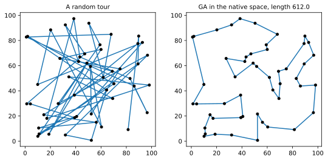

# Test problems

`ypea.problems` has ready made problems from engineering design, combinatorial optimization and allocation, and readers for the standard instance libraries. Every problem is a vectorized `ypea.Problem` with its constraints, its best known value as `optimum` when one is known, and `info["source"]` naming where it comes from.

## Engineering design

Six constrained design problems in their most cited formulations. Each has the best known solution in `info["x_opt"]`, stored with full precision and feasible.

| Function | Variables | Constraints | Best known f | Source |
|---|---|---|---|---|
| `pressure_vessel()` | 2 integer thicknesses, 2 reals | 4 | 6059.714335 | Sandgren 1990, Kannan and Kramer 1994 |
| `pressure_vessel(mixed=False)` | 4 reals | 4 | 5885.332774 | the continuous version |
| `welded_beam()` | 4 reals | 7 | 1.724852 | Coello 2000 |
| `spring()` | 3 reals | 4 | 0.012665233 | Belegundu 1982, Arora 1989 |
| `speed_reducer()` | 7 reals | 11 | 2994.471066 | Golinski 1973, Mezura-Montes and Coello 2005 |
| `three_bar_truss()` | 2 reals | 3 | 263.8958434 | Nowacki 1973, Ray and Saini 2001 |
| `gear_train()` | 4 integers | none | 2.700857e-12 | Sandgren 1990 |

```python
import ypea

problem = ypea.problems.welded_beam()
result = ypea.LSHADE(max_nfe=20_000).solve(problem, seed=1)
print(result.best.obj_value, result.best.feasible, problem.optimum)
```

```text
1.7248523085973648 True 1.7248523085975365
```

The docstring of each function gives the formulas, the bounds and the variants found in the literature.

## Combinatorial problems

| Function | Variable | Notes |
|---|---|---|
| `tsp(coords=None, distances=None)` | `Permutation("tour", n)` | Euclidean distances from coordinates, or any (also asymmetric) distance matrix |
| `random_tsp(n, seed)` | `Permutation("tour", n)` | cities placed at random in a square |
| `circle_tsp(n=30, radius=40, seed=None)` | `Permutation("tour", n)` | the TSP of the YPEA for MATLAB SA example. The optimum is the perimeter of the polygon. |
| `knapsack(values, weights, capacity)` | `Binary("x", n)` | 0/1 knapsack, or multidimensional when `weights` is a matrix (maximization) |
| `integer_knapsack(values, weights, capacity, upper)` | `Integer("x", n)` | each item may be packed up to `upper[i]` times |
| `matlab_knapsack()` | `Binary("x", 20)` | the knapsack of the YPEA for MATLAB documentation (optimum 73) |
| `mknap1()` | `Binary("x", n)` | the 7 multidimensional knapsack problems of OR-Library file mknap1 (Petersen 1967) |
| `qap(flow, distance)` | `Permutation("p", n)` | quadratic assignment, with the cost of QAPLIB |
| `nqueens(n=8)` | `Permutation("q", n)` | the number of queen pairs on a common diagonal (optimum 0) |

```python
problem = ypea.problems.nqueens(12)
result = ypea.SA(max_nfe=20_000, initial_temp=1, final_temp=0.01, space="native").solve(problem, seed=1)
print(result.best.obj_value, result.best.solution.q)
```

```text
0.0 [ 9  7  2  0  6  1 10  5  3  8 11  4]
```

`plot_tour(problem, result)` draws the best tour of a TSP with coordinates (needs matplotlib).

<figure markdown="span">
  
  <figcaption><code>random_tsp(50, seed=2)</code>: a random tour (left) and the tour found by <code>GA(max_nfe=50_000, space="native")</code> with seed 1 (right), drawn with <code>plot_tour</code>.</figcaption>
</figure>

## Allocation and assignment

| Function | Variables | Notes |
|---|---|---|
| `cvrp(coords, demands, capacity, n_vehicles)` | `Permutation("route", n + k - 1)` | capacitated vehicle routing. Node 0 is the depot. Values n and above separate the routes. |
| `gap(cost, resource, capacity, sense="min")` | `Integer("machine", n)` | generalized assignment of n jobs to m machines with capacities |
| `orlib_gap(index=1)` | `Integer("machine", 15)` | problem c515-index of OR-Library gap1 (5 machines, 15 jobs, maximization) |
| `hub_location(flows, costs, p, alpha)` | `Selection("hubs", n, p)` and `Integer("alloc", n)` | single allocation p-hub median |
| `cab(n=25, p=2, alpha=0.2)` | as above | the CAB data set of O'Kelly (1987), from OR-Library |
| `transportation(cost, supply, demand)` | `FixedSum("x", (m, n), target=supply, axis=1)` | every source ships all of its supply, and the demands are constraints |

`cvrp_routes(problem, solution)` turns a CVRP solution into its list of routes, and `hub_allocation(hubs, alloc)` gives the hub of every node. `plot_routes(problem, solution)` draws the routes.

```python
problem = ypea.problems.orlib_gap(1)
result = ypea.GA(max_nfe=20_000, mutation_prob=0.5, space="native").solve(problem, seed=1)
print(problem.name, result.best.obj_value, result.best.feasible, problem.optimum)
```

```text
c515-1 334.0 True 336
```

The run comes close to the optimum of 336. Tightly constrained assignment problems are hard for general methods, so give them a larger budget or several runs.

## Instance files

Readers for the standard libraries return ready problems:

| Reader | Library | Returns |
|---|---|---|
| `read_tsplib(path)`, `read_tsplib_tour(path)` | TSPLIB (TSP and ATSP) | a TSP problem, with the optimum of the known instances in `TSPLIB_OPTIMA`, and an optimal tour (0 based) |
| `tsplib_distances(coords, kind)` | TSPLIB | the distance matrix for an edge weight type: EUC_2D, EUC_3D, MAN_2D, MAN_3D, MAX_2D, MAX_3D, CEIL_2D, ATT or GEO |
| `read_qaplib(path)`, `read_qaplib_solution(path)` | QAPLIB | a QAP problem (optima in `QAPLIB_OPTIMA`), and a solution `(cost, p)` |
| `read_orlib_mknap(path)` | OR-Library mknap | a list of multidimensional knapsack problems |
| `read_orlib_gap(path, sense="max")` | OR-Library gap | a list of GAP problems (optima in `ORLIB_GAP_OPTIMA`) |
| `read_orlib_cab(path)` | OR-Library phub | the flows and costs of the CAB data |
| `read_cvrplib(path)` | CVRPLIB | a CVRP problem |

## Sources and licenses

Three OR-Library files ship with the package, unchanged: `mknap1` (multidimensional knapsack), `gap1` (generalized assignment) and `phub4` (the CAB data). OR-Library (J. E. Beasley) makes all of its material available under the MIT license, and the notices in the package data folder give the full text and the papers to cite.

TSPLIB and QAPLIB publish no license or redistribution terms, and CVRPLIB provides its instances for research use without clear redistribution rights. So no files of these libraries are included. Download the instances from the libraries and use the readers above.
