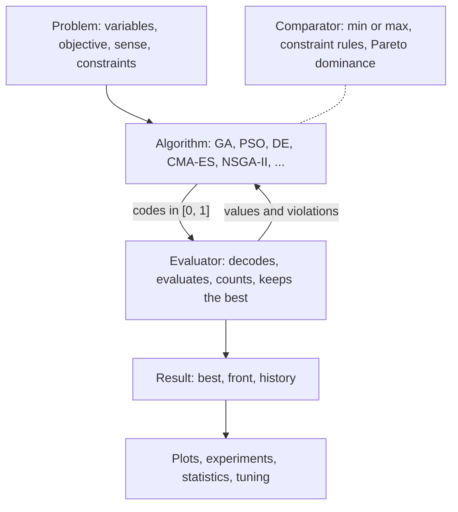
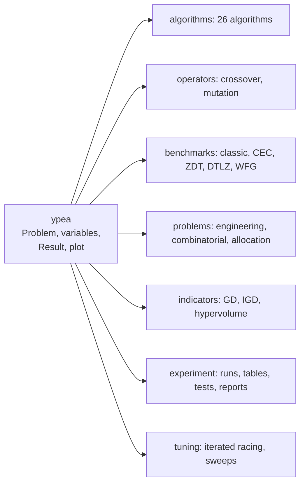

# YPEA for Python

Yarpiz Evolutionary Algorithms (YPEA) is a Python toolbox of metaheuristics. You define an optimization problem once, then solve it with any of 26 algorithms: evolutionary algorithms, swarm intelligence methods, CMA-ES, adaptive differential evolution, multi-objective algorithms, and two reference methods.

It is the Python version of [YPEA for MATLAB](https://github.com/smkalami/ypea), redesigned, with the known defects fixed and each algorithm checked against its paper.

- **One problem, every algorithm.** All variable types (real, integer, binary, permutation, selection, partition, fixed sum) are encoded in [0, 1], so every algorithm solves every problem.
- **Constraints built in.** The objective may return `(f, g)` with `g <= 0`. Deb's feasibility rules are the default, and a penalty method is the alternative.
- **Reproducible.** The same seed gives the same result. The evaluation budget is never exceeded, and every improvement of the best solution is recorded with its evaluation count.
- **Fast when you need it.** Vectorized objectives get the whole population at once, and an executor evaluates solutions in parallel.
- **Benchmarks and test problems.** 26 classic functions with optional shift and rotation, the CEC 2017 and CEC 2022 suites checked against the official C code, and engineering, combinatorial and allocation problems.
- **Experiments.** Run many algorithms on many problems, resume interrupted studies, and get statistical tests, LaTeX and Markdown tables, figures and an HTML report.

## Install

```text
pip install ypea              # needs only NumPy
pip install "ypea[plot]"      # with matplotlib for plots
pip install "ypea[stats]"     # with SciPy for the statistical tests of experiments
```

YPEA needs Python 3.12 or newer.

## A 30 second example

Find 20 real numbers in [-10, 10] that minimize the sphere function:

```python
import ypea

problem = ypea.Problem(
    vars=ypea.Real("x", shape=20, lb=-10, ub=10),
    objective=lambda sol: ypea.benchmarks.sphere(sol.x),
    name="sphere",
)

pso = ypea.PSO(max_iter=100, pop_size=100, w=0.5, wdamp=1, c1=1, c2=2)
result = pso.solve(problem, seed=1)

print(result.best.obj_value)
print(result.best.solution.x[:3])
```

```text
5.6749849058892247e-05
[-0.00202772 -0.00125066 -0.00097624]
```

Any other algorithm solves the same problem:

```python
result = ypea.DE(max_nfe=20_000).solve(problem, seed=1)
print(result.summary())
```

```text
DE on sphere
  best objective value: 0.0287753
  feasible: True (violation 0)
  evaluations: 20000, iterations: 199, time: 0.0942 s, stopped by: max_nfe
```

## How it fits together



You describe the problem once with variables and an objective. The algorithm searches codes in [0, 1] and never sees your variable types. The evaluator decodes each code, calls your objective, counts the evaluations and keeps the best solution (or the front) exactly. Every comparison of two solutions goes through the comparator, which alone knows whether you minimize or maximize and how constraints count.

The package is organized the same way:



Start with [Getting started](getting-started.md), then read the [user guide](guide/problems.md) or pick an [algorithm](algorithms/index.md).

## Citing

If you use YPEA in your research, please cite it. See [Citing](citing.md).

## License

MIT. The bundled benchmark and test problem data keep the terms of their sources (see [Benchmarks](guide/benchmarks.md) and [Test problems](guide/test-problems.md)).
